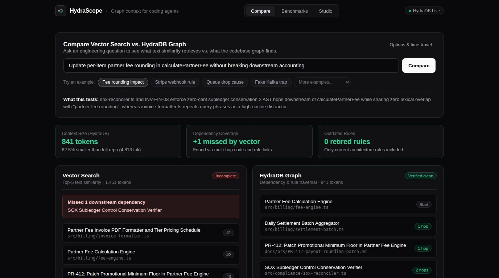
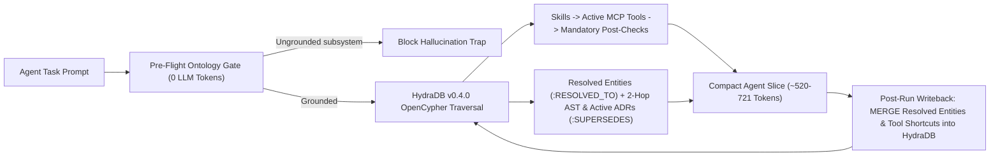

# HydraScope

**Live Agent Context Layer (Skills, 64 MCP Tool Definitions, Resolved Entities, and Multi-Hop AST/ADR Lineage) Built on Self-Hosted HydraDB (`v0.4.0`)**

[**Launch Live Demo (`https://hydrascope.krusch.dev`)**](https://hydrascope.krusch.dev) · [**Watch Loom Walkthrough (`4m 45s`)**](https://www.loom.com/share/eb71cc14722b4e47a24cd95972261b59) · [**Read Architecture Write-Up (`krusch.dev`)**](https://krusch.dev/articles/hydrascope-agent-context-on-hydradb)



Most agent stacks preload dozens of MCP tool schemas into every prompt window (`12,000+` tokens before Turn 1) or bolt on a flat cosine vector store that retrieves deprecated v1 tools, misses mandatory post-check tools that share zero vocabulary with the user prompt, and repeats entity-lookup round-trips on every run.

I built **HydraScope** on the open-source **HydraDB (`v0.4.0`)** graph engine ([`hydra-db/hydradb`](https://github.com/hydra-db/hydradb)) as a live, self-sharpening context store for AI agents. HydraScope stores an agent's **Skills**, **MCP Tool Definitions**, **Resolved Entities**, and **Code/ADR Lineage** in HydraDB, traverses only the structural subgraph each task requires, and writes newly resolved entity aliases and co-executed tool paths back into HydraDB after every run.

---

## Architecture: How HydraDB Powers the Context Layer



### Why Plain Vector Stores and Tool Preloading Fail Here
1. **Zero-Lexical-Overlap Tool & Code Dependencies**: Refunding a disputed Stripe invoice (`stripe_v2_idempotent_refund`) requires running double-entry cent conservation (`ledger_verify_cent_conservation`) and appending an HMAC receipt (`audit_append_signed_receipt`). In `1024d` embedding space (`snowflake-arctic-embed2`), those mandatory post-check tools score `< 0.20` cosine similarity to `"partner invoice refund"` and are missed `100%` of the time. HydraDB walks `(Skill)-[:IMPACTS*1..2]->(McpTool)` deterministically.
2. **Temporal Supersession Poisoning (`:SUPERSEDES`)**: Deprecated tools (`stripe_v1_legacy_charge_refund`) and retired Architecture Decision Records (`ADR-003: SHA-1 webhook check`) often share *more* surface keywords with user prompts than their v2 replacements (`ADR-014: HMAC-SHA256`), causing vector stores to inject retired rules at rank `#1`. HydraScope traverses `:SUPERSEDES` edges to block retired tools/ADRs at `HEAD` while supporting exact `asOf` historical time-travel replay.
3. **Continual Entity & Path Compression Across Runs**: A flat vector store has no structural memory of entities resolved on prior turns (`"Acme Logistics" -> acct_partner_99281`), forcing repeated lookup tool round-trips. HydraScope persists `:RESOLVED_TO` entity nodes and compressed tool chains into HydraDB via OpenCypher `MERGE`, collapsing multi-turn fan-out chains into a single pass.
4. **Zero-Token Pre-Flight Answerability Shield**: When asked about subsystems absent from the architecture (`Kafka`, `Kubernetes`), vector stores still return `top-k` neighbors (`cosine ~0.50`), tempting the model to fabricate configurations. HydraScope grounds domain nouns against the HydraDB ontology first and halts ungrounded traps at `0` tokens.

---

## Measured Benchmarks, Baselines, and Continual Learning

All benchmarks are reproducible via `npm run continual`, `npm run bench`, and `npm run load` against self-hosted `ghcr.io/hydra-db/hydradb:0.4.0` and real `1024d` `snowflake-arctic-embed2` dense embeddings (with a deterministic `256d` hashed n-gram cosine fallback when running offline).

### 1. Track 2 Agent Context Layer: 64 MCP Tools + Continual Learning (`Epoch 1 -> Epoch 4`)

Workload: `8` MCP servers (`stripe`, `ledger`, `redis`, `pagerduty`, `vault`, `postgres`, `github`, `audit` = `64` tool schemas totaling `12,412` preload tokens) across multi-turn operational tasks with recurring organization/cluster entities and retired v1 tool traps.

| Context Strategy | Tool Recall | Tool Precision | Tool F1 | Single-Turn Ready | Deprecated Tool Poison | Mean Round-Trips | Mean Prompt Tokens |
| :--- | :---: | :---: | :---: | :---: | :---: | :---: | :---: |
| **Baseline 1: Preload All 64 MCP Tools** | `100.0%` | `4.7%` | `9.0%` | `0.0%` | `100.0%` | `2.50` | `12,412` |
| **Baseline 2: Dense `1024d` Vector Top-5** | `33.3%` | `20.0%` | `25.0%` | `0.0%` | `100.0%` | `5.00` | `1,132` |
| **HydraScope Epoch 1 (Cold Graph)** | `100.0%` | `75.0%` | `85.7%` | `0.0%` | **`0.0%`** | `2.50` | `883` |
| **HydraScope Epoch 2 (+Resolved Partner)** | `100.0%` | `87.5%` | `93.3%` | `50.0%` | **`0.0%`** | `1.75` | `802` |
| **HydraScope Epoch 3 (+Resolved Cluster)** | `100.0%` | `93.8%` | `96.8%` | `75.0%` | **`0.0%`** | `1.38` | `761` |
| **HydraScope Epoch 4 (Converged Graph)** | **`100.0%`** | **`100.0%`** | **`100.0%`** | **`100.0%`** | **`0.0%`** | **`1.00`** | **`721` (`-94.2%`)** |

### 2. Multi-Hop Code AST + Temporal ADR Suite (`8` Scenarios)

| Retrieval Arm | Scenario Pass Rate | Critical Multi-Hop Recall | Temporal Poisoning | Trap Block Rate | Mean Prompt Tokens |
| :--- | :---: | :---: | :---: | :---: | :---: |
| **Full-Repo Stuffing** | `50.0%` (`4/8`) | `100.0%` | `100.0%` | `0.0%` | `4,813` |
| **Dense `1024d` Vector Top-K (`k=4`)** | `12.5%` (`1/8`) | `77.8%` | `100.0%` | `0.0%` | `1,257` |
| **HydraScope Structural Graph (`hydradb:0.4.0`)** | **`100.0%` (`8/8`)** | **`100.0%`** | **`0.0%`** | **`100.0%`** | **`520` (`-89.2%`)** |

### 3. Self-Hosted `hydradb:0.4.0` Concurrent OpenCypher Load Test
- **Workload**: `64` concurrent mixed OpenCypher multi-hop `MATCH` traversals and 1-hop `MERGE` mutations across `8` parallel workers on `ghcr.io/hydra-db/hydradb:0.4.0`.
- **Measured Result**: **`64 / 64` (`100%`) succeeded**, **`~409 ops/sec`**, **`P50 = 11.7ms`**, **`P95 = 40.6ms`**, **`P99 = 58.7ms`**, verified via monotonic `sgk:1:...` read-epoch bookmarks.

---

## Dogfooding `@hydradb/selfgraph` (`HydraDBStore` + `KuzuStore`) in My Stack

Alongside direct `hydradb:0.4.0` OpenCypher execution, HydraScope natively integrates [`@hydradb/selfgraph`](./src/connectors/selfgraph-store.js) (`hydra-db/selfgraph`) so my daily IDE MCP server (`hydrascope-mcp`) and homelab personal assistant (`krusch-companion`) share the same typed bi-temporal knowledge-graph primitives:
- **Dual Store Support (`HydraDBStore` over Bolt + Embedded `KuzuStore`)**: Connects to self-hosted `hydradb:0.4.0` over Bolt (`HYDRADB_BOLT_URI=bolt://127.0.0.1:7687`) via `HydraDBStore` and falls back out-of-the-box to embedded `KuzuStore` for zero-daemon local CLI and MCP sessions.
- **Personalized PageRank (`strategy: "ppr"`) & Cardinality Supersession (`max_count: 1`)**: Compiles `Skill`, `McpTool`, `CodeSymbol`, `AdrRule`, and `ResolvedEntity` nodes into `HYDRASCOPE_SELFGRAPH_SCHEMA` with `contradiction: "supersede"` (`max_count: 1` on `ACTIVE_RULE_FOR` and `RESOLVED_TO`), `asOf` / `knownAt` time-travel replay, `readiness()` lint diagnostics, and known-time `graph.diff(since, until)` windows.
- **CLI, HTTP, and MCP Access**: Run `npm run selfgraph -- "Update partner fee rounding in calculatePartnerFee"`, query `GET /api/selfgraph/status` or `POST /api/selfgraph/retrieve`, or pass `engine: "selfgraph"` to `hydrascope_traverse_context` over stdio MCP. While integrating SelfGraph into my stack, I also contributed `9` upstream bugfix PRs (`#149`, `#156`, `#157`, `#167`, `#179`, `#180`, `#208`, `#215`, and `#243`) back to `hydra-db/selfgraph`.

---

## Real HydraDB `v0.4.0` Engineering Details

HydraScope talks directly to the open-source `ghcr.io/hydra-db/hydradb:0.4.0` HTTP OpenCypher query engine (`POST /v1/graphs/{graph_id}/query` with `X-Graph-Namespace` and `Authorization: Bearer`) in [`src/connectors/hydradb-client.js`](./src/connectors/hydradb-client.js):
- **Collision-Free 48-Bit Integer Surrogate Keys**: Maps string logical IDs (`tool:stripe_v2_idempotent_refund`, `adr:ADR-014`) via SHA-256 to deterministic safe integers (`1000..9007199254740000`) matching HydraDB's native integer vertex ID requirement.
- **One-Hop Directed `MERGE` Dialect Alignment**: HydraDB `v0.4.0`'s query engine executes one-hop edge patterns in `MERGE` (`MERGE (root:WorkspaceRoot {id: 1000})-[:CONTAINS]->(n:GraphNode {...})` and `MERGE (a:GraphNode)-[:IMPACTS]->(b:GraphNode)`) while stripping `null` parameter fields.
- **Typed Cell Unwrapping & Epoch Bookmarks**: Decodes HydraDB typed row envelopes (`{"type":"string","value":...}`) and surfaces live `read_epoch` and `sgk:1:...` consistency bookmarks directly in the UI inspector.

---

## Go-To-Market: Who Buys HydraScope

- **Target Customer**: Engineering and SRE organizations running internal coding, incident-response, or finance operations agents across `5+` MCP servers (`40-200` tools) where prompt-window bloat drives `$2k-$15k/mo` in wasted frontier token spend and deprecated tool calls cause production incidents.
- **Bottom-Up PLG Wedge (`npx hydrascope bench`)**: Any developer can point HydraScope at a local repo in 30 seconds to quantify their exact 2-hop blind spots and token waste against vector search, then deploy self-hosted **HydraDB** (`docker compose --profile hydradb up -d`) + the **HydraScope MCP Server** (`hydrascope-mcp`) across Claude Code, Cursor, Codex, and Windsurf.

---

## Quick Start

```bash
cp .env.example .env
npm install
npm run build
npm test
npm start
```

Open `http://127.0.0.1:4190` to launch the 3-tab **HydraScope** UI:
1. **`Compare`**: Prompt-first search with 4 plain-English example presets, a 3-stat verdict bar, side-by-side Vector Search vs. HydraDB Graph results, a 3-step dependency path diagram, `asOf` time-travel (`Today` vs. `2026-03-01`), and a collapsible OpenCypher + prompt inspector.
2. **`Benchmarks`**: Unified 8-task codebase retrieval scorecard, 64-tool continual learning curve (`85.7% -> 100%` F1, `5.0 -> 1.0` round-trips, `-94.2%` tokens), and live 64-query `hydradb:0.4.0` throughput runner.
3. **`Studio`**: Retire and replace active ADRs live in HydraDB (`:SUPERSEDES`), replay historical dates, or compile a local repository folder into the graph.

### Run Self-Hosted HydraDB `v0.4.0` via Docker Compose

```bash
docker compose --profile hydradb up -d
```

### CLI & Stdio MCP Server

```bash
node bin/hydrascope.js continual
node bin/hydrascope.js bench
node bin/hydrascope.js load --requests 64 --concurrency 8
node bin/hydrascope.js query "Update partner fee rounding in calculatePartnerFee"
```

Attach to Claude Code, Cursor, or Antigravity via stdio MCP (`HYDRASCOPE_WORKSPACE_ROOT` defaults to `process.cwd()` so `hydrascope_ingest_directory` can compile any repository inside your active workspace):

```json
{
  "mcpServers": {
    "hydrascope": {
      "command": "node",
      "args": ["/path/to/hydrascope/src/mcp/hydrascope-mcp.js"],
      "env": {
        "HYDRASCOPE_WORKSPACE_ROOT": "/path/to/your/workspace"
      }
    }
  }
}
```

## License

MIT License (`Copyright (c) 2026 kruschdev`). Built with pre-existing MIT open-source [`@krusch/toolkit`](https://github.com/kruschdev/toolkit) HTTP/MCP/security/embedding runtime bricks and self-hosted [`hydra-db/hydradb`](https://github.com/hydra-db/hydradb) (`v0.4.0`, ELv2).
